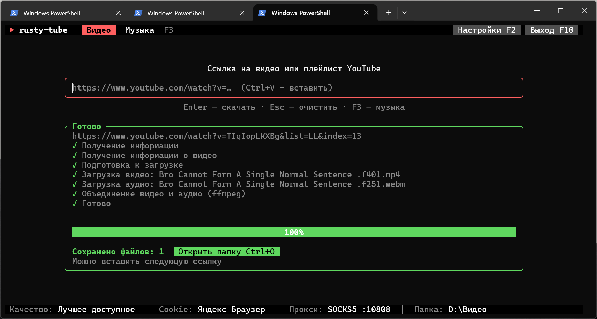

# rusty-tube

Консольная программа для загрузки видео с YouTube и музыки с YouTube Music. Работает на
Windows и macOS: вставили ссылку, нажали Enter, получили файл в лучшем доступном качестве.

Под капотом — [yt-dlp](https://github.com/yt-dlp/yt-dlp) и [ffmpeg](https://ffmpeg.org).
Программа сама ставит и обновляет их через менеджер пакетов: [scoop](https://scoop.sh)
на Windows, [Homebrew](https://brew.sh) на macOS. Ничего настраивать вручную не нужно.



## Возможности

- **Видео и плейлисты.** Лучшее видео и лучший звук склеиваются в один файл. Плейлист
  скачивается в отдельную папку, файлы пронумерованы по порядку.
- **Музыка.** Поиск по YouTube Music прямо в программе, загрузка треков, альбомов
  и плейлистов в Opus, M4A или MP3. В файл записываются обложка, исполнитель, альбом,
  год и номер трека.
- **Cookie из браузера.** Программа берёт вход в YouTube из вашего браузера, поэтому
  скачиваются видео с возрастным ограничением, видео для спонсоров и Premium-качество звука.
- **Прокси.** Можно качать через локальный SOCKS5-прокси, например через порт VPN-клиента.
- **Удобный интерфейс в терминале.** Прогресс, скорость и оставшееся время видны
  во время загрузки. Работает клавиатура и мышь.

## Установка

### Windows

Нужны Windows 10 или 11 и [Rust](https://rustup.rs).

```powershell
git clone https://github.com/waysharknite/rusty-tube.git
cd rusty-tube
cargo build --release
.\target\release\rusty-tube.exe
```

`rusty-tube.exe` — самостоятельный файл, его можно перенести в любую папку.

### macOS

Подходят Mac на Apple Silicon и на Intel.

1. Поставьте инструменты разработчика, если их ещё нет:
   ```sh
   xcode-select --install
   ```
2. Поставьте [Homebrew](https://brew.sh), если его ещё нет. Программа не может сделать это
   сама: установщику Homebrew нужен пароль администратора.
   ```sh
   /bin/bash -c "$(curl -fsSL https://raw.githubusercontent.com/Homebrew/install/HEAD/install.sh)"
   ```
3. Поставьте Rust:
   ```sh
   curl --proto '=https' --tlsv1.2 -sSf https://sh.rustup.rs | sh
   ```
4. Соберите и запустите программу:
   ```sh
   git clone https://github.com/waysharknite/rusty-tube.git
   cd rusty-tube
   cargo build --release
   ./target/release/rusty-tube
   ```

Чтобы запускать программу командой `rusty-tube` из любой папки, скопируйте её в каталог
из `PATH`:

```sh
sudo cp target/release/rusty-tube /usr/local/bin/
```

Программа работает в любом терминале: Terminal.app, iTerm2, Ghostty и других.

## Первый запуск

Программа проверяет, всё ли на месте, и предлагает поставить недостающее:

1. **Менеджер пакетов.** На Windows scoop ставится автоматически. На macOS без Homebrew
   программа покажет команду установки и закроется. После выхода команда останется
   в терминале, её можно скопировать.
2. **yt-dlp, ffmpeg и deno.** deno — движок JavaScript: без него YouTube отдаёт yt-dlp
   не все форматы. На Windows может понадобиться ещё git, он нужен scoop для обновлений.
   Если отказаться от установки, программа закроется.
3. **Обновления.** Программа обновляет списки пакетов и предлагает поставить новые версии.
   YouTube часто меняет сайт, поэтому свежий yt-dlp важен. Шаг можно пропустить клавишей Esc.
4. **Настройки.** Откроются один раз. Их можно поменять позже клавишей F2.
5. **Cookie.** Программа берёт cookie из выбранного браузера. Шаг можно пропустить
   клавишей Esc.

Следующие запуски проходят те же проверки, но быстро и без вопросов, если ничего не изменилось.

## Как пользоваться

### Видео

Вставьте ссылку в поле по центру и нажмите Enter. Подходят ссылки вида `youtube.com/watch?v=…`,
`youtu.be/…`, `youtube.com/shorts/…` и ссылки на плейлисты. `https://` можно не писать.

- **Одно видео** сохраняется как `Название.mkv` (или `.mp4`, `.webm` — смотря что отдаёт YouTube).
- **Плейлист** сохраняется в папку с его названием: `001 - Название.mkv`, `002 - …`.
- **Видео из плейлиста** (`watch?v=…&list=…`): программа спросит, скачать весь плейлист
  или только это видео.

Если загрузка оборвалась, повторите её: yt-dlp докачает файл, а уже скачанные пропустит.

### Музыка

Клавиша F3 или клик по вкладке «Музыка» переключает режим.

**Поиск.** Введите название песни или исполнителя и нажмите Enter. Программа ищет
в разделе «Песни» YouTube Music и показывает первые 10 результатов. Список заполняется
постепенно, около 2 секунд на трек, но выбирать можно сразу. Стрелка ↓ переводит к списку,
Enter или повторный клик скачивает трек.

**Ссылка.** Вместо запроса можно вставить ссылку на трек, альбом
(`music.youtube.com/browse/MPREb…`) или плейлист.

- Одиночный трек: `Исполнитель - Трек.opus`.
- Альбом или плейлист: папка с названием, внутри `01 - Исполнитель - Трек.opus`, `02 - …`.

**Форматы** выбираются в настройках:

| Формат | Качество                         | Когда выбирать                            |
|--------|----------------------------------|-------------------------------------------|
| Opus   | ~130–160 кбит/с, без перекодирования | По умолчанию: лучшее, что отдаёт YouTube |
| M4A    | ~128 кбит/с AAC, без перекодирования | Для техники Apple и старых телефонов     |
| MP3    | VBR V0, с перекодированием       | Для магнитол и плееров, которые знают только MP3 |

С YouTube Premium и рабочими cookie звук будет в Opus 256 кбит/с, программа выберет его сама.

**Теги и обложка.** Записываются название, исполнитель, альбом, исполнитель альбома,
дата релиза (а не дата загрузки на YouTube) и номер трека для альбомов. Обложка обрезается
до квадрата. У музыкальных клипов вместо обложки альбома будет кадр из видео: так их
отдаёт YouTube.

## Настройки

Открываются клавишей F2.

| Параметр          | Что задаёт |
|-------------------|------------|
| Качество видео    | Максимальная высота кадра: от 360p до 4K или лучшее доступное. Если нужной высоты нет, берётся ближайшая меньшая |
| Формат музыки     | Opus, M4A или MP3 (см. выше) |
| Cookie из браузера | Откуда брать вход в YouTube, или «Не использовать» |
| SOCKS5 прокси (порт) | Порт локального SOCKS5-прокси на `127.0.0.1`. Пустое поле — без прокси |
| Папка для видео   | По умолчанию «Видео» на Windows, `~/Movies` на macOS |
| Папка для музыки  | По умолчанию «Музыка» на Windows, `~/Music` на macOS |

Папку можно вписать вручную или выбрать в системном окне кнопкой «Обзор…».

Файл настроек:

- Windows: `%APPDATA%\rusty-tube\config.toml`
- macOS: `~/Library/Application Support/rusty-tube/config.toml`

### Cookie

Cookie нужны, чтобы YouTube считал вас вошедшим в аккаунт. Без них не скачать видео
с возрастным ограничением, а YouTube чаще требует подтвердить, что вы не робот.

Программа выгружает cookie из браузера при каждом запуске и после смены браузера
в настройках. Они сохраняются в `cookies.txt`:

- Windows: `%LOCALAPPDATA%\rusty-tube\cookies.txt`
- macOS: `~/Library/Application Support/rusty-tube/cookies.txt`

Если выгрузка не удалась или в браузере нет входа в YouTube, программа оставит файл
с прошлого запуска. Если прошлого файла нет, загрузка пойдёт без cookie.

**Windows**

| Браузер        | Примечание |
|----------------|------------|
| Chrome         | — |
| Brave          | Закройте браузер: пока он запущен, файл cookie заблокирован |
| Firefox        | — |
| Яндекс Браузер | Закройте браузер полностью, включая значок в трее: в фоне он блокирует файл cookie |

**macOS**

| Браузер        | Примечание |
|----------------|------------|
| Chrome         | macOS спросит доступ к связке ключей «Chrome Safe Storage». Нажмите «Разрешать всегда», иначе вопрос будет при каждом запуске |
| Brave          | То же, что у Chrome, но ключ называется «Brave Safe Storage» |
| Firefox        | Работает без дополнительных шагов |
| Safari         | Дайте Терминалу «Полный доступ к диску»: Системные настройки → Конфиденциальность и безопасность. Затем перезапустите Терминал |
| Яндекс Браузер | Может не работать: yt-dlp ищет ключ шифрования под именем Chrome, а Яндекс хранит его под своим. Если входа в YouTube нет, выберите другой браузер |

### Прокси

Если YouTube у вас открывается только через VPN, укажите порт SOCKS5-прокси VPN-клиента.
Через прокси идёт и трафик, и DNS-запросы (`socks5h://127.0.0.1:<порт>`), поэтому
блокировки по DNS тоже обходятся.

## Клавиши

| Клавиша            | Действие |
|--------------------|----------|
| Enter              | Скачать по ссылке / найти музыку |
| Ctrl+V, Shift+Ins  | Вставить из буфера обмена (на macOS ещё Cmd+V) |
| Esc                | Очистить поле / остановить поиск / прервать загрузку |
| F2                 | Настройки |
| F3                 | Переключить режим: видео или музыка |
| ↑ ↓, PgUp, PgDn    | Выбор трека в результатах поиска |
| Tab                | Переход между полем, списком и кнопками |
| Ctrl+O             | Открыть папку с загрузками |
| F10, Ctrl+Q        | Выход |

Кнопки и вкладки работают и по клику мышью.

На клавиатуре Mac F-клавиши нажимаются вместе с Fn: Fn+F2, Fn+F3.

## Если что-то не работает

**«Sign in to confirm you're not a bot» или видео недоступно.** Выберите в настройках
браузер, в котором вы вошли в YouTube, и перезапустите программу. Если не помогло,
обновите yt-dlp: перезапустите программу и согласитесь на обновление.

**Cookie не выгружаются.** Посмотрите подсказку в сообщении об ошибке. Обычно браузер
нужно закрыть (Windows) или дать доступ к связке ключей или к диску (macOS).

**Скачивается низкое качество.** Проверьте, что установлен deno: без него YouTube отдаёт
не все форматы. Программа ставит deno сама при первом запуске.

**На macOS: «Homebrew не найден», хотя он установлен.** Программа ищет `brew`
в `/opt/homebrew/bin`, `/usr/local/bin` и в `PATH`. Если Homebrew стоит в другом месте,
задайте переменную `HOMEBREW_PREFIX`.

**Обновить вручную.** Windows: `scoop update yt-dlp ffmpeg deno`. macOS:
`brew upgrade yt-dlp ffmpeg deno`.

## Разработка

```sh
cargo build            # отладочная сборка
cargo test             # тесты
cargo clippy --all-targets
```

| Файл              | Что внутри |
|-------------------|------------|
| `src/main.rs`     | Точка входа, инициализация терминала |
| `src/app.rs`      | Состояние программы, сценарий запуска, обработка клавиш и мыши |
| `src/ui.rs`       | Отрисовка интерфейса ([ratatui](https://ratatui.rs)) |
| `src/download.rs` | Запуск yt-dlp, выгрузка cookie, разбор прогресса |
| `src/music.rs`    | Поиск в YouTube Music |
| `src/config.rs`   | Настройки и пути к файлам |
| `src/worker.rs`   | Фоновые задачи и запуск внешних процессов |
| `src/scoop.rs`    | Менеджер пакетов на Windows |
| `src/brew.rs`     | Менеджер пакетов на macOS (и Linux) |

`scoop.rs` и `brew.rs` дают одинаковый интерфейс. В `main.rs` один из них подключается
под именем `packages` в зависимости от платформы.

Проверить, что код собирается под macOS, можно и на Windows:

```sh
rustup target add aarch64-apple-darwin
cargo clippy --all-targets --target aarch64-apple-darwin
```

## Лицензия

MIT.
